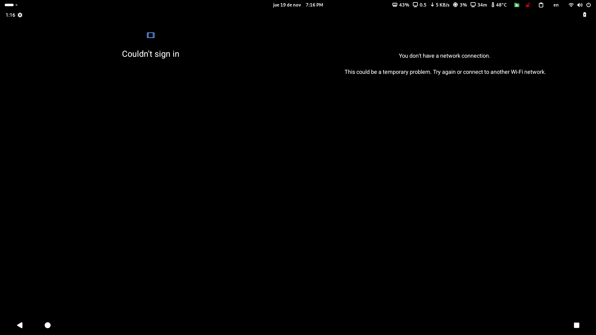
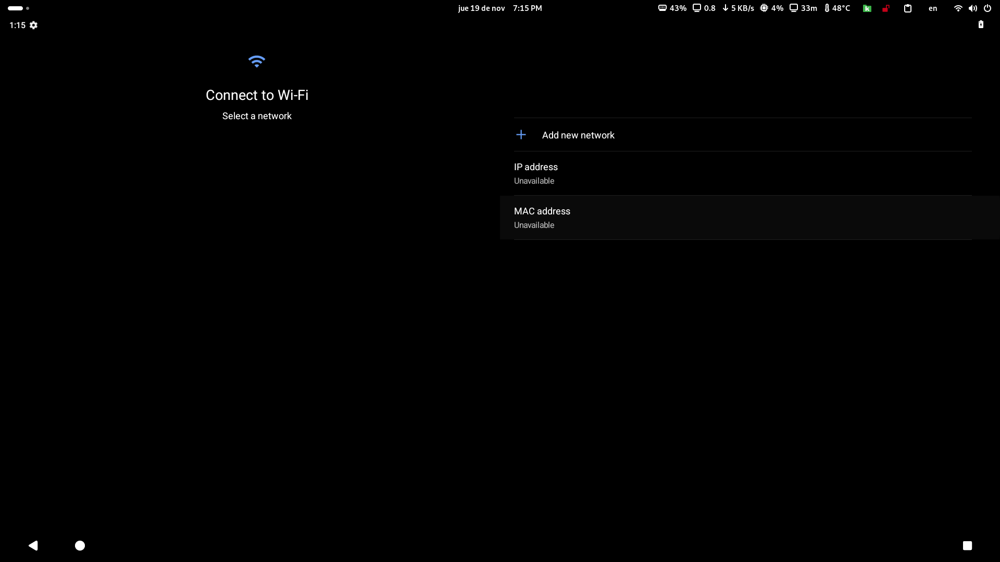

# Diagnóstico: Waydroid sin conexión a internet en Debian 13 (Trixie)

**Entorno:** Debian 13 "Trixie" con Waydroid 1.6.3 instalado desde
`trixie-backports`, imagen GAPPS, host con firewalld activo.

## Síntoma

Waydroid inicia correctamente, pero Android no tiene conexión a internet.
La Play Store muestra el error:

    Couldn't sign in
    You don't have a network connection.

La app de WiFi no muestra redes (comportamiento esperado: el contenedor
no controla la radio inalámbrica del host; la pantalla vacía no es el
problema ni un indicador válido del estado de la red).

## Diagnóstico

Verificar si la interfaz `eth0` del contenedor tiene una IPv4 asignada:

    usuario@debian:~$ sudo waydroid shell
    :/ # ip addr show eth0
    2: eth0@if7: <BROADCAST,MULTICAST,UP,LOWER_UP> mtu 1500 qdisc noqueue state UP group default qlen 1000
        link/ether 00:16:3e:f9:d3:03 brd ff ff:ff:ff:ff:ff:ff link-netnsid 0
        inet6 fe80::14c6:6f2e:6b84:1908/64 scope link stable-privacy
           valid_lft forever preferred_lft forever

**Hallazgo:** `eth0` solo tiene una IPv6 link-local (rango `fe80::/10`,
válido únicamente para comunicación en el mismo enlace, no enrutable a
internet). No recibió dirección IPv4.

## Causa raíz

Waydroid crea en el host una interfaz puente `waydroid0` (subred
192.168.240.0/24) con un servidor DHCP interno (dnsmasq) que entrega la
IPv4 al contenedor. **firewalld** estaba filtrando ese tráfico (DHCP,
puertos 67/68, y el forwarding de la subred), por lo que el contenedor
nunca completaba el préstamo DHCP y quedaba sin IPv4, sin DNS y sin
salida a internet.

Referencias: issues #1346 y #143 del repositorio waydroid/waydroid.

## Solución

Permitir el tráfico de la red interna de Waydroid asignando `waydroid0`
a la zona `trusted` de firewalld:

    sudo firewall-cmd --permanent --zone=trusted --add-interface=waydroid0
    sudo firewall-cmd --reload

Reiniciar el servicio del contenedor para que solicite IP de nuevo:

    sudo systemctl restart waydroid-container

Cerrar y volver a abrir la sesión de Waydroid.

## Verificación

Dentro del contenedor, `eth0` debe mostrar ahora una IPv4 del rango
192.168.240.0/24:

    sudo waydroid shell
    ip addr show eth0
    # inet 192.168.240.x/24 ...

Confirmar navegación en el navegador de Android e inicio de sesión en
la Play Store.

## Notas

- Asignar `waydroid0` a `trusted` es seguro en un equipo de escritorio:
  esa interfaz es interna del host y solo existe localmente.
- Si persistiera el fallo, verificar `net.ipv4.ip_forward=1` en el host
  y la masquerade en la zona de salida de firewalld:
      sudo firewall-cmd --permanent --zone=public --add-masquerade
      sudo firewall-cmd --reload
- Si la red funciona pero la Play Store sigue rechazando el inicio de
  sesión, registrar el ANDROID_ID del dispositivo en la página de
  registro de dispositivos de Google.
